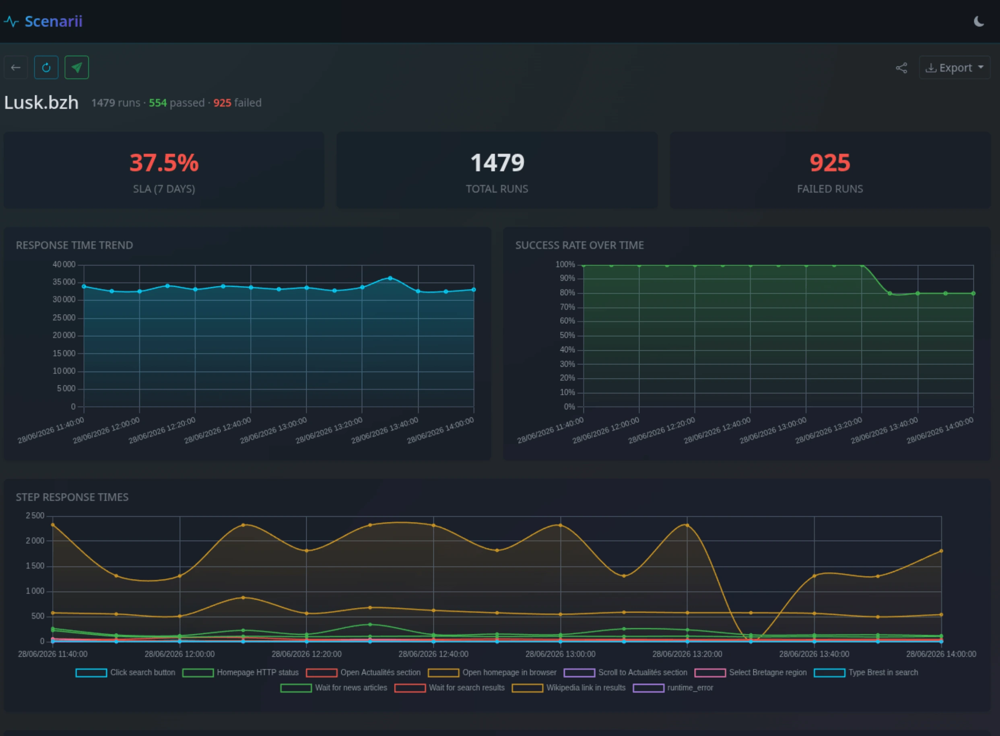
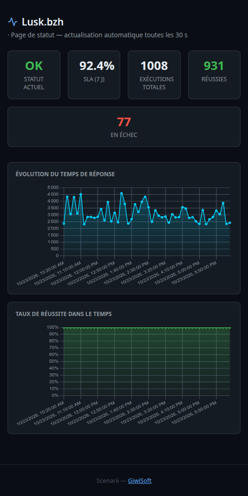

<p align="center">
  
</p>

<p align="center">
  YAML-defined HTTP and browser scenarios, scheduled or triggered from CI, with metrics, dashboards, and alerts.
</p>

<p align="center">
  <a href="https://github.com/Giwi/giwisoft-scenarii/wiki">Documentation</a> ·
  <a href="https://github.com/Giwi/giwisoft-scenarii/wiki/API">REST API</a> ·
  <a href="https://github.com/Giwi/giwisoft-scenarii/wiki/Deployment">Deployment</a>
</p>

## Highlights

- **HTTP + browser checks** in one scenario file, using native `fetch` or Lightpanda.
- **Scheduling and CI triggers**: cron, time windows, dependencies, API runs, GitHub/GitLab webhooks.
- **Staging and production** from the same scenario with `--env` profiles.
- **Alerts** on Telegram, email, Slack, Discord, Teams, ntfy, PagerDuty, and signed webhooks.
- **Observability**: pass-rate heatmap, p95 latency, flakiest scenarios, run diffs, screenshots.
- **SQLite or PostgreSQL** storage with retention and scheduled backups.
- **Dashboard, REST API, scoped API tokens, OIDC, TOTP.**

## Screenshots

<p align="center">
  
</p>

| Scenario list | Dark theme |
|---------------|------------|
|  |  |

<p align="center">
  
</p>

## Quick start

Requirements: **Node.js 26+**.

```bash
npm install
npm run build
node dist/index.js server
```

Open <http://localhost:3000>. On first start Scenarii creates an `admin` user and prints a generated password to the logs.

Run a scenario without the dashboard:

```bash
node dist/index.js trigger scenarios/lusk.yml --fail-on none
```

## Minimal scenario

```yaml
name: Smoke
base_url: https://example.com
schedule: "*/5 * * * *"

steps:
  - name: Homepage
    action: http.get
    url: /
    expect:
      status: 200
      body_contains: Example Domain
```

```bash
node dist/index.js validate scenarios/smoke.yml
node dist/index.js trigger scenarios/smoke.yml --env staging
```

## CLI

| Command | Purpose |
|---------|---------|
| `server` | API, dashboard, scheduler, WebSocket |
| `validate [file]` | Validate YAML, schema, cron, required fields (`--all`, `--json`) |
| `trigger <file>` | Run immediately (`--fail-on none`, `--env staging`, `--db ...`) |
| `status` | Scheduled scenarios and storage status |
| `user <action>` | Manage users (`list`, `add`, `passwd`, `role`, `del`) |
| `config` | Generate a settings template (`-o path`) |

Server options and automation examples are in the [CLI documentation](https://github.com/Giwi/giwisoft-scenarii/wiki/CLI).

## Docker

```bash
docker build -f Containerfile -t scenarii .
docker run -d --name scenarii -p 3000:3000 \
  -v "$PWD/scenarios:/app/scenarios" \
  -v "$PWD/db:/app/db" \
  -v "$PWD/data:/app/data" \
  scenarii
```

Compose, PostgreSQL, reverse proxy, and systemd examples: [Deployment](https://github.com/Giwi/giwisoft-scenarii/wiki/Deployment).

## Documentation

The full documentation lives in the [GitHub wiki](https://github.com/Giwi/giwisoft-scenarii/wiki).

| Topic | Page |
|-------|------|
| Installation and first run | [Installation](https://github.com/Giwi/giwisoft-scenarii/wiki/Installation) |
| First scenario walkthrough | [Getting Started](https://github.com/Giwi/giwisoft-scenarii/wiki/Getting-Started) |
| Scenario YAML, includes, conditions | [Scenarios](https://github.com/Giwi/giwisoft-scenarii/wiki/Scenarios) |
| HTTP and browser actions | [Actions](https://github.com/Giwi/giwisoft-scenarii/wiki/Actions) |
| Variables, secrets, extraction | [Variables and Secrets](https://github.com/Giwi/giwisoft-scenarii/wiki/Variables-and-Secrets) |
| Staging/production profiles | [Environments](https://github.com/Giwi/giwisoft-scenarii/wiki/Environments) |
| Cron, pause/resume, alert thresholds | [Scheduling](https://github.com/Giwi/giwisoft-scenarii/wiki/Scheduling) |
| Alert channels and webhook signing | [Notifications](https://github.com/Giwi/giwisoft-scenarii/wiki/Notifications) |
| GitHub/GitLab CI triggers | [Inbound Webhooks](https://github.com/Giwi/giwisoft-scenarii/wiki/Webhooks) |
| Endpoint reference and examples | [REST API](https://github.com/Giwi/giwisoft-scenarii/wiki/API) |
| Pages, overview, run diff | [Dashboard](https://github.com/Giwi/giwisoft-scenarii/wiki/Dashboard) |
| Local users, OIDC, TOTP, tokens | [Authentication](https://github.com/Giwi/giwisoft-scenarii/wiki/Authentication) |
| SQLite/PostgreSQL, backups | [Storage](https://github.com/Giwi/giwisoft-scenarii/wiki/Storage) |
| Full `settings.yml` reference | [Configuration](https://github.com/Giwi/giwisoft-scenarii/wiki/Configuration) |
| Troubleshooting | [Troubleshooting](https://github.com/Giwi/giwisoft-scenarii/wiki/Troubleshooting) |

## Development

```bash
npm run dev        # API + Angular HMR
npm test           # backend build + all tests
npm run lint       # tsc --noEmit
```

Project layout and extension guides: [Development](https://github.com/Giwi/giwisoft-scenarii/wiki/Development).

## License

GPL-3.0. See [LICENSE](LICENSE).
